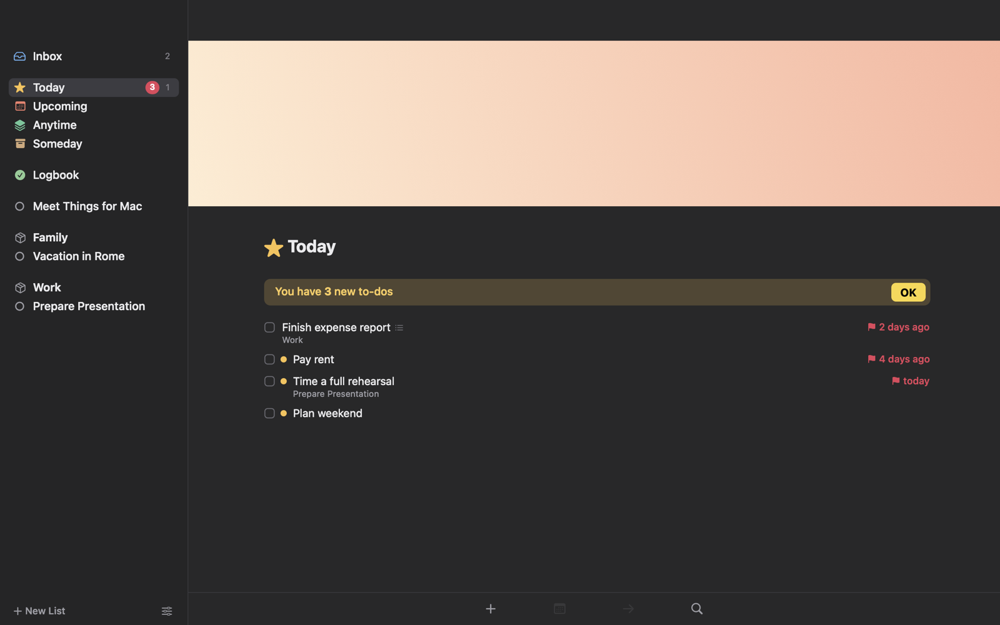
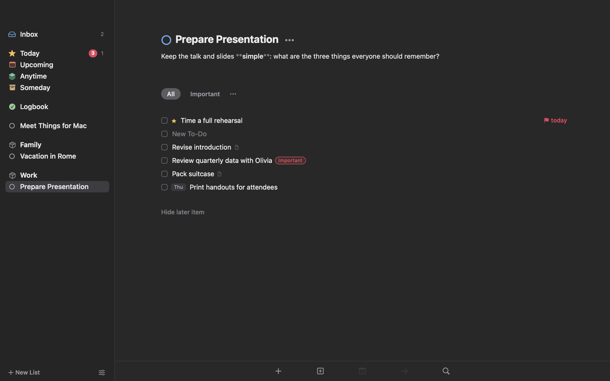

<h1 align="center">Things 4</h1>

<p align="center">
  <b>A native macOS task manager in the spirit of Things 3.</b><br>
  Local-first, keyboard-first, with reminders on your iPhone and an API your AI agents can use.
</p>

<p align="center">
  <a href="LICENSE"></a>
  
  
  
</p>

<p align="center">
  
</p>

## Features

- **The Things 3 workflow**: Inbox, Today, This Evening, Upcoming, Anytime, Someday and Logbook, plus areas, projects, headings, checklists, tags, deadlines and repeating to-dos.
- **Keyboard-first**: Quick Entry from any app (⌃Space), Autofill links from Safari, Mail or Finder (⌃⌥Space), Quick Find (⌘F), and full undo.
- **Reminders that reach your phone**: Mac notifications with Complete and Snooze, mirrored to Apple Reminders so your iPhone and Apple Watch ring too.
- **Calendar events** from iCloud, Google and Outlook appear alongside Today and Upcoming.
- **Notes as pages**: live Markdown, plus drop-in links to emails, files and web pages.
- **Extras**: Notion-style cover images, a focus timer, a menu bar list, Markdown and PDF export, and an optional AI sidebar you can switch off.
- **Yours**: one SQLite file on your Mac, with no account, no sync server and no telemetry.

<p align="center">
  
</p>

## Let your agents give you work

<p align="center">
  
</p>

Things 4 has four ways in for other apps, scripts and AI agents. Set them up in **Settings › API**.

**MCP**: gives Claude Code, Claude Desktop, Cursor or your own harness tools such as `add_todo`, `add_project`, `add_area`, `get_todo` and `search_todos`.

```sh
claude mcp add --scope user things4 -- "/Applications/Things 4.app/Contents/MacOS/Things4" --mcp
```

**HTTP**: JSON on `127.0.0.1` only, with a bearer token from Settings or `~/Library/Application Support/Things4/api.json`.

```sh
curl http://127.0.0.1:7474/v1/tasks -H "Authorization: Bearer $TOKEN" \
  -d '{"title": "Read chapter 4", "when": "today", "tags": ["learning"], "reminder": "6pm"}'
```

**CLI**: install it with one click in Settings.

```sh
things4 add "Borrowing exercises" --when tomorrow --list "Learn Rust" --heading "Week 1"
things4 search --tag learning --completed-since 2026-11-01
```

**URL scheme**: Things 3's commands under `things4:///`, for Shortcuts, Raycast and web pages.

```
things4:///add?title=Read%20chapter%204&when=today&tags=learning
```

**Agents organise their own work.** Each agent's to-dos are tagged with its name, so you can filter your tutor's tasks in one click. Set the name with `"env": {"THINGS4_SOURCE": "tutor"}` in the MCP config, or send an `X-Things-Source` header. If an agent names a project or area that doesn't exist yet, Things 4 creates it, and headings inside projects are created too.

`GET /v1` lists every endpoint. Dates accept `today`, `evening`, `friday`, `in 3 days`, `tomorrow 9am` or `2026-11-20@14:30`.

## Install

Build from source on macOS 14 or later. You need Xcode or the Command Line Tools.

```sh
git clone https://github.com/mazidhee/things-4.git && cd things-4
./build.sh                       # builds "build/Things 4.app" (universal)
./scripts/package.sh 1.1.0       # optional: build/Things4-1.1.0.dmg
cp -R "build/Things 4.app" /Applications/
```

The app is ad-hoc signed. On first launch, right-click it and choose **Open**.

## Development

```
Sources/Things4/
  Models/  Store/      data model and SQLite store with undo
  UI/      Settings/   AppKit views, lists, editor, popovers
  Support/             reminders, calendar, API server, MCP and CLI, export, Markdown
  AI/                  optional AI sidebar
```

To run the tests, use `"build/Things 4.app/Contents/MacOS/Things4" --selftest` for the store and parsers, or `--uitest` for the UI. Point `THINGS4_DB=/tmp/scratch.sqlite` at a scratch database so your own data stays untouched.

## Disclaimer

Things 4 is an independent project and is not affiliated with Cultured Code. *Things* is a trademark of Cultured Code GmbH & Co. KG.

## License

[MIT](LICENSE)
